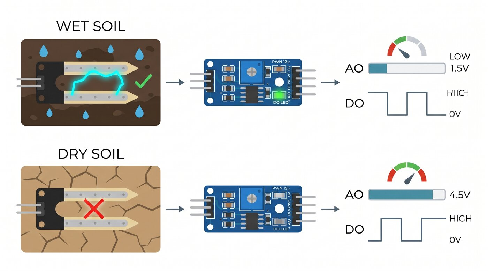
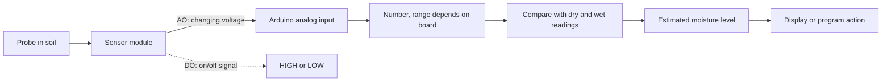

# Resistive soil moisture sensors

A resistive probe has two metal tracks. Soil between them carries electricity. Damp soil often carries it more easily than dry soil, so the sensor module's output changes. Soil type, fertilizer, salts, and probe placement affect the reading too.

This overview is illustrative. Pin order, component labels, and values can differ between boards. Check your module before wiring it.

The voltage numbers are examples, not specifications. The digital trace shows the output changing between two states, not a continuous moisture reading.

## AO and DO

Many modules have two outputs. `AO` is the changing measurement: its voltage rises or falls as the sensor reading changes. An Arduino's `analogRead` function turns that voltage into a number. On an Uno the number runs from 0 to 1023; other boards may use a different range. For example, with a 5 V measuring range, 2.5 V reads about 512 on an Uno.

`DO` is an on/off signal. A small screw on many modules sets the point where it switches between `HIGH` and `LOW`. A program could use it to turn on an LED when the soil crosses that point. It only says which side of the point the reading is on, not how wet the soil is. The HIGH/LOW direction can differ between modules. The example sketch uses `AO`; it does not need `DO`.

## Set the dry and wet points

A percentage from this kind of sensor is a comparison, not a direct measurement of water content. Pick two reference readings for your sensor: one in dry soil and one in the same soil after watering. Set the sketch's `RAW_DRY` and `RAW_WET` values to those readings. A reading halfway between them becomes about 50%. The values vary between sensors and soils, so there is no single pair that works for everyone.

The sketch also assigns labels to percentage ranges. Those labels are just display text, not watering advice. Adjust the ranges to suit your project. The displayed minimum and maximum are the lowest and highest readings since the sketch started; they reset when the board restarts.

## Probe care

The exposed metal can corrode if it stays powered in wet soil. Remove the probe between readings when practical. If readings drift, inspect the tracks and take new dry and wet readings.

## Further reading

- [SparkFun soil moisture sensor guide](https://learn.sparkfun.com/tutorials/soil-moisture-sensor-hookup-guide)
- [Arduino analogRead reference](https://docs.arduino.cc/language-reference/en/functions/analog-io/analogRead/)
- [Arduino digitalRead reference](https://docs.arduino.cc/language-reference/en/functions/digital-io/digitalRead/)
