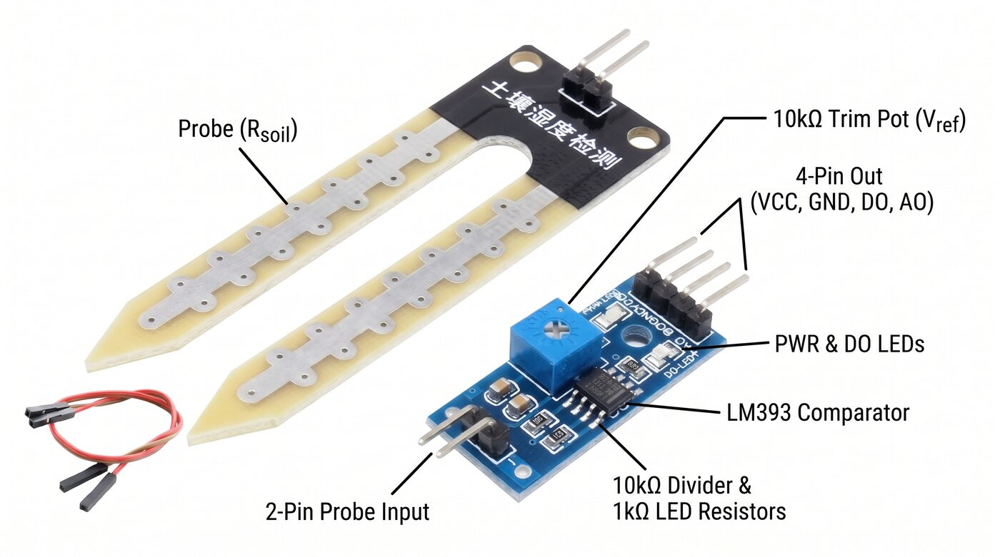
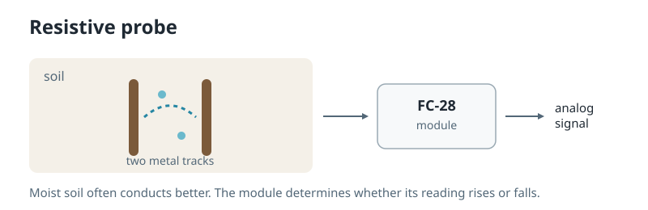
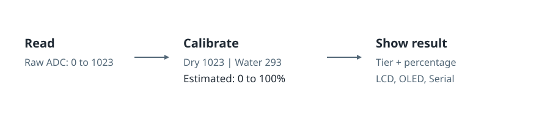

# How the soil moisture reading works

## The sensor in one minute

The FC-28 probe has two exposed metal tracks. Soil between them forms part of an electrical path. Wetter soil often conducts electricity more easily, so the sensor module sees a change and turns it into an output voltage. Soil type, salts, fertilizer, and probe contact can also affect that reading.

This supplied illustration is a visual guide, not a verified schematic. Board layouts and component values vary between FC-28 versions and clones. Follow the labels on your own board before wiring it.

## Analog and digital outputs

Many FC-28 modules expose both `AO` and `DO`. They answer different questions:

| Pin | What it gives you | Example |
|---|---|---|
| `AO` (analog out) | A changing voltage that represents the sensor reading. Connect it to an analog input such as Uno `A0`. | With a nominal 5 V ADC reference, 2.5 V reads about 512 out of 1023. This is only an example. |
| `DO` (digital out) | One of two logic states, `HIGH` or `LOW`, when the reading crosses a threshold set with the module's small screw potentiometer. | A controller can use it to switch an indicator when the soil crosses the chosen threshold. It does not provide a percentage. |

The threshold's direction and whether the active state is `HIGH` or `LOW` can vary by module. Test yours rather than assuming.

This project connects `AO` to `A0` and uses it for the displayed reading. It does not use `DO`.

## How this sketch turns a reading into a percentage

The Uno's analog-to-digital converter turns the voltage at `A0` into a raw number from 0 to 1023. The sketch maps its two configured reference readings to an estimated 0 to 100% scale, then chooses a label for the display.

The current settings are `RAW_DRY = 1023` and `RAW_WET = 293`. For this module, lower raw readings mean wetter conditions. For example, raw `658` maps to about `50%` with these settings. The reported water readings were about 275 to 311, so 293 is a convenient midpoint, not a soil-specific measurement.

This percentage is a relative estimate, not a universal measure of water content. For better results, record repeatable readings in the soil you will use, once dry and once thoroughly watered, then set `RAW_DRY` and `RAW_WET` to those readings. The dry reference must be greater than the wet reference in this sketch. Readings beyond the reference points are limited to 0% or 100%.

## The six labels

These are simple ranges in the code, not care rules that fit every plant:

| Label | Estimated reading |
|---|---:|
| BONE DRY | below 10% |
| DRY | 10% to 24% |
| MOIST | 25% to 39% |
| WET | 40% to 59% |
| SOAKED | 60% to 79% |
| FLOODED | 80% to 100% |

`MIN` and `MAX` on the display are the lowest and highest raw readings seen since startup. They reset when the Arduino restarts.

## A note on probe life

The FC-28 is resistive and has exposed metal. Keeping it powered in wet soil can corrode the probe and change its readings. Remove it between measurements when practical, and recalibrate if readings drift. It is useful for rough comparisons, not precision irrigation control.

## Learn more

- [SparkFun Soil Moisture Sensor Hookup Guide](https://learn.sparkfun.com/tutorials/soil-moisture-sensor-hookup-guide) explains resistive sensing, analog readings, wiring, and calibration.
- [Arduino analogRead reference](https://docs.arduino.cc/language-reference/en/functions/analog-io/analogRead/) explains how an analog voltage becomes a number.
- [Arduino digitalRead reference](https://docs.arduino.cc/language-reference/en/functions/digital-io/digitalRead/) explains reading a digital `HIGH` or `LOW` state.
